<div align="center">

# Tina & Emmanuel

### Two rivers, one journey

A wedding invitation told as a single scroll-painting: two watercolor streams rise in the mountains, travel side by side, and become one.

**[tinaandemmanuel.me](https://tinaandemmanuel.me)**


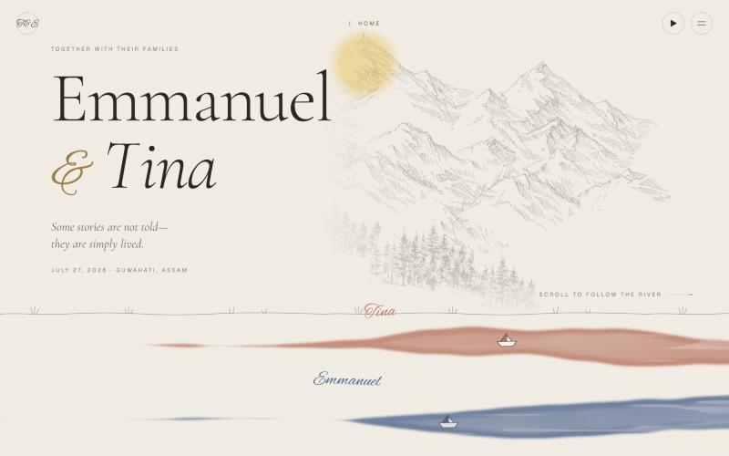

</div>

## The idea

Most wedding sites are a stack of sections. This one is a single place you travel through. Scrolling down moves the world sideways, so the page reads like a long painted scroll: the sun crosses the sky, the paper warms from dawn to dusk, and the couple walks the riverbank only while you scroll.

Each partner has a colour. Tina is the rose stream, Emmanuel the indigo. Where they meet, the river rises over the whole screen and the two colours slowly steep into one while a poem is read. Everything after that is one river.

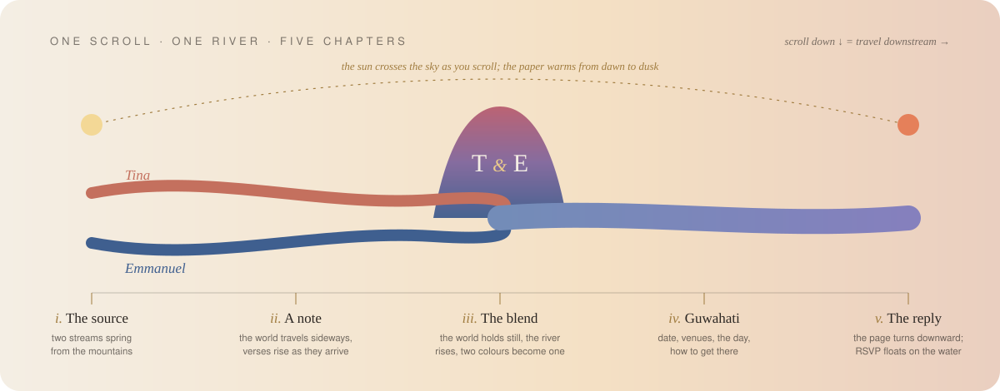

## A walk through

| | |
|:--|:--|
| 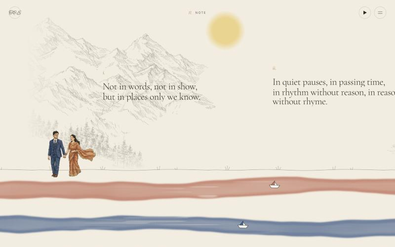 | 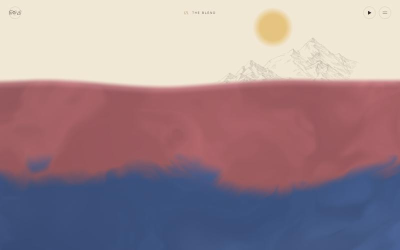 |
| **ii. A note.** Verses arrive from the right and rise out of a mask as the world carries them in. The couple is a green-screen film keyed in WebGL that only advances while you scroll. | **iii. The river rises.** At the confluence the world holds still and the waterline climbs from the river, in the river's own colours. |
| 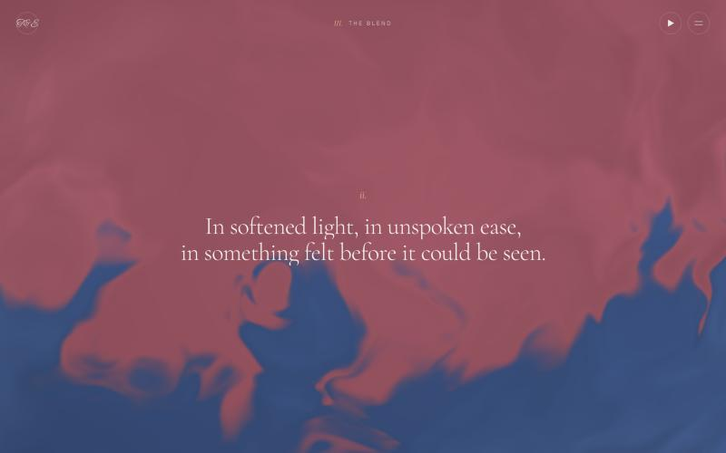 | 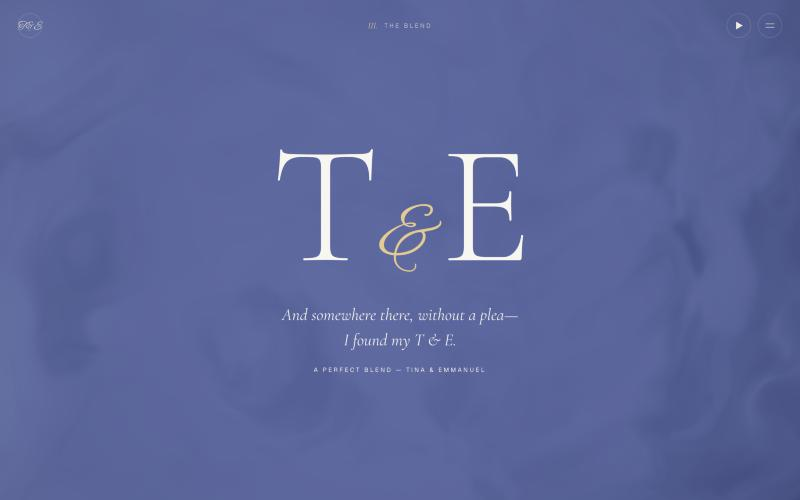 |
| **Steeping.** One verse at a time, while the two pigments marble into each other. The pointer stirs the water and a tap sends a ring across it. | **The blend.** The colours settle into one and the initials arrive from either side. Then the water drains back into the river. |
| 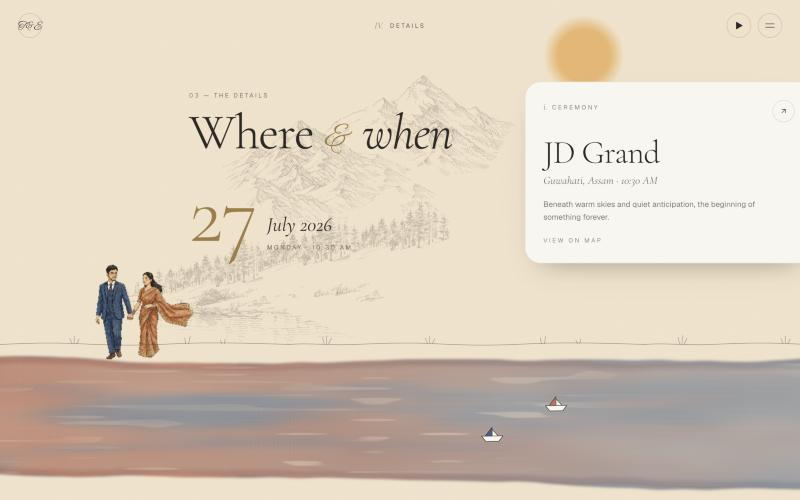 | 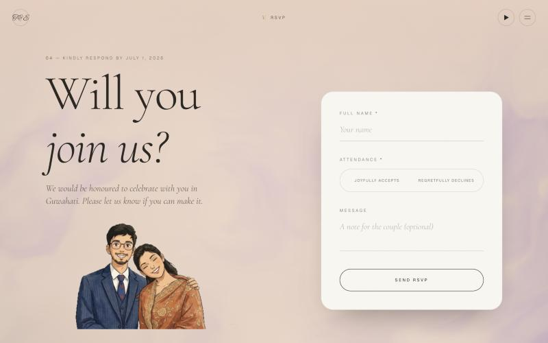 |
| **iv. Guwahati.** Date, venues, the day's schedule and travel, on cards that lean toward the pointer. | **v. The reply.** The page turns downward and the RSVP floats on the same water at dusk. |

## How it is built

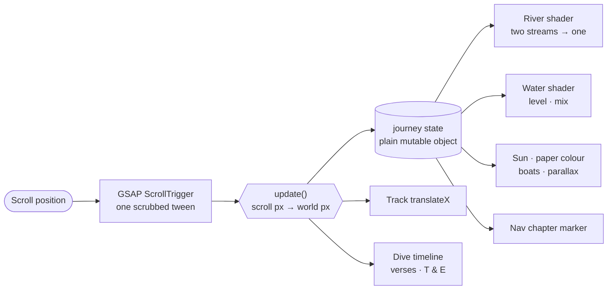

One scrubbed tween is the only thing that listens to scroll. It writes a handful of numbers into a plain object, and every moving part reads from that object on its own frame. Nothing passes through React state while you scroll, so there are no re-renders in the hot path and nothing can drift out of step.

**Scroll to world mapping.** One pixel of scroll is one pixel of travel, except at the confluence, where five screens of scroll are spent with the world held still:

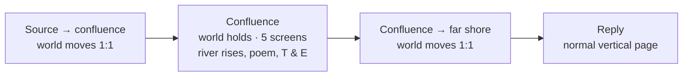

**What is drawn where**

| Layer | Technique |
|:--|:--|
| River | Fragment shader (OGL). Two soft-edged ribbons with pigment pooled at the edges, subtractive colour over the paper, dry-brush ripples. Merge point and source are uniforms fed from DOM positions. |
| Water | Second fragment shader. Domain-warped noise for currents, a waterline with a swell, two pigments separated by a seam that marbles as `mix` rises. Rendered at half resolution. |
| Mountains | Scanned pencil sketches converted to transparent ink layers, drifting at 30% of the world's speed. Cropped edges are masked so the pencil trails off. |
| Couple, save-the-date, RSVP art | MP4 with a green background, keyed to transparency in a shader, so no alpha video format is needed. |
| Type | GSAP SplitText with masked lines and characters. Cormorant Garamond, Alex Brush, Geist. |
| Loader | Two SVG paths drawn by real load progress, joined by a gold line when everything is ready. |

## Decisions worth explaining

- **OGL instead of three.js.** The scenes are full-screen quads with fragment shaders. OGL does that in a few kilobytes; a scene graph would be dead weight.
- **`position: sticky` instead of ScrollTrigger pinning.** The stage is a sticky viewport inside a section whose height is set from the track's width. The browser does the pinning, so there is no pin-spacer and no jump on resize.
- **Start states live in CSS.** Every hidden starting state in the confluence sequence is a class, and tweens only animate *to* the resting state. Reloading mid-sequence or refreshing ScrollTrigger cannot leave two verses on screen at once. This replaced a version that used `from` values and broke on reload.
- **One tween per property per element.** Layers fade in on an outer element and out on an inner one, so scrubbing backwards never has two tweens fighting over the same value.
- **Performance budget.** Shaders run below device resolution and pause when off screen or covered. Video pauses off screen. No backdrop blur, blend modes or animated grain on moving layers; an earlier version had them and dropped frames.
- **Static export.** The site is plain files on GitHub Pages. Personal links such as `/Guest-Name` are served by the 404 page, which renders the same invitation and greets the guest by name.
- **Reduced motion.** With `prefers-reduced-motion`, the journey becomes a normal vertical page with every verse visible and the shaders off.

## Four versions

The design went through four complete builds before this one shipped.

| Version | Concept | Why it was replaced |
|:--|:--|:--|
| v1 | Editorial layout with a particle-heart canvas | Effects felt overdone and the page lagged |
| v2 | "Steeped": a full-screen tea shader the page dives into | Beautiful liquid, but it read as a tea brand, not a wedding |
| v3 | Two rivers and a horizontal journey | Right story, but the confluence was just another panel |
| **v4** | v3's river with v2's liquid at the confluence | Shipped |

## Run it

```bash
npm install
```

```bash
npm run dev
```

```bash
npm run build
```

Node 24. `npm run build` writes the static site to `out/`. Pushing to `main` deploys it through the workflow in `.github/workflows/deploy.yml`.

The RSVP form posts to a Google Apps Script URL read from `NEXT_PUBLIC_SCRIPT_URL`. Without it the form still runs and simply skips the request.

## Where things are

```
src/
├─ app/
│  ├─ page.tsx          the whole page, in order
│  ├─ not-found.tsx     personal guest links (/Guest-Name)
│  └─ globals.css       tokens, type, the few global styles
├─ components/
│  ├─ Journey.tsx       the stage, the track, scroll mapping, the confluence sequence
│  ├─ River.tsx         watercolor river shader
│  ├─ Water.tsx         rising water and RSVP water shader
│  ├─ ChromakeyVideo.tsx  green-screen keying in WebGL
│  ├─ Loader.tsx        the two-stream preloader
│  └─ Navbar · RSVP · Footer · MusicPlayer · CustomCursor
└─ lib/
   ├─ journey.ts        shared scroll state and helpers
   └─ constants.ts      names, date, venues, poems
```

<div align="center">
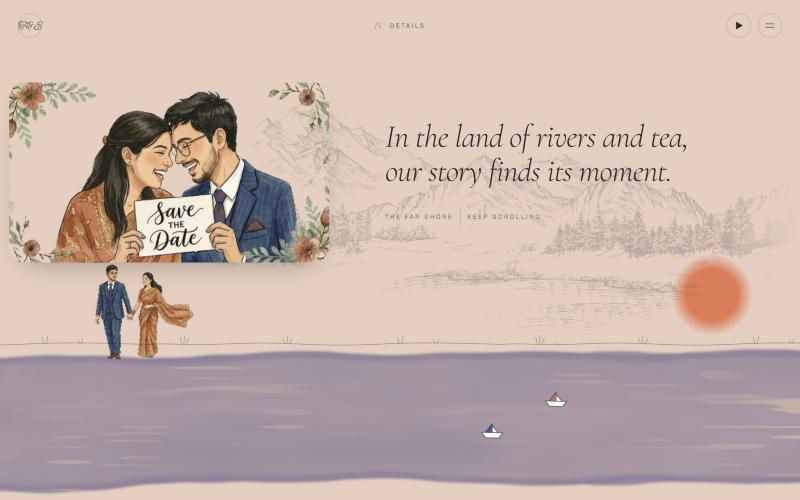

*In the land of rivers and tea, our story finds its moment.*
</div>
